# Local Syftr Optimizer Study

Research Methodology Project

Hemant Singh IIT2024047
Parth Khatri IIT2024002
Vardaan Gupta IIT2024046

Completed evidence as of 16 November 2026

We compare a local Syftr style multiobjective TPE reference with three implemented evolutionary search strategies under the same declared RAG evaluation budget. The main experiment uses a restricted native Syftr space, a pinned Qwen model, HotPotQA and two objectives: answer F1 and generator token usage.

The hybrid method attained the highest observed hypervolume at 25 attempts per method. The result is exploratory: only one optimizer seed and ten search questions were evaluated, repeated configurations sometimes produced different answers, and native holdout confirmation did not produce a usable returned result.

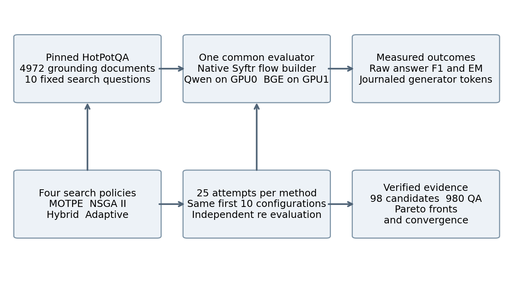


# How to use this document

This document explains the research from RAG fundamentals through source implementation and audited findings. It is an implementation and evidence dossier for preparing the final institutional report and presentation. The supplied proposal and base paper are distinguished from what was actually measured.

| Part | What it explains |
| --- | --- |
| Foundations and proposal | RAG, Pareto optimization, the Syftr paper and our research question |
| Adaptation and experiment design | Local model, hardware, conditional space, metrics and common evaluator |
| Algorithms and implementation | MOTPE, NSGA II, hybrid injections and adaptive mutation |
| Measured results | Final ranking, convergence, distributions, raw question behavior and caveats |
| Research interpretation | Questions answered, limitations, compact supporting study and future work |
| Implementation handover | Exact source, evidence, reproduction steps, configuration and references |

## Evidence reading rule

Numerical results below are measurements or deterministic calculations from the returned records. An explanation of why a method behaved a certain way is labelled as a possible mechanism unless the logs directly establish it. Absence of a holdout result is not treated as a successful holdout evaluation.

The native restricted experiment and the compact 27 setting study are separate experiments. Their hypervolumes use different cost references and their question counts differ. Their scores must not be combined into one leaderboard.

## Primary result in one sentence

Hybrid had observed HV 0.444376 versus 0.392754 for the local MOTPE reference, a relative increase of 13.14 percent, at the same 25 attempted configurations; this is a descriptive search result rather than evidence of universal or statistically significant superiority.


# RAG and configuration optimization from basics

A language model produces an answer from the information in its prompt and its learned parameters. Retrieval augmented generation adds a retrieval step: documents are divided into chunks, a question is matched to relevant chunks, and those chunks are supplied to a generator as evidence. This makes it possible to use a corpus without retraining the generator.

An embedding model converts text into vectors so that semantically related queries and passages can be compared. Dense retrieval uses these vectors; sparse retrieval emphasizes term matching, such as BM25; hybrid retrieval combines signals. A reranker revisits retrieved passages and changes their order. A splitter determines how much text each chunk contains and how adjacent chunks overlap.

More retrieved information can help an answer, but it also consumes prompt tokens and can distract the generator. A stronger workflow may make extra model calls for rewriting, decomposition, hypothetical documents or subquestions. The total resource cost is therefore not determined by retrieval depth alone.

## Three different roles

| Role | In this project |
| --- | --- |
| Generator | Pinned Qwen2.5 7B instruct model in Q4_K_M format |
| Embedding model | BGE small or BGE base in the native restricted search |
| Optimizer | Chooses RAG configurations; it does not train Qwen or change its weights |

A configuration is one concrete set of active workflow choices. A candidate evaluation constructs that workflow, answers the same ten search questions, and records quality and tokens. A search method decides which configuration to evaluate next. Our intervention is at this proposal stage while the evaluation pipeline is shared.

## Why optimization is needed

The conditional configuration space is too large for exhaustive native evaluation under the available budget. The practical question is which optimizer finds useful quality and resource tradeoffs with a small number of expensive model evaluations. The final observed frontier is an empirical frontier of evaluated configurations, not a proof that no better configuration exists anywhere.


# Quality tokens dominance and Pareto fronts

We maximize quality Q and minimize resource T. A configuration dominates another if it has at least as high quality and at most as much resource use, with at least one strict improvement. Non dominated configurations form the observed Pareto front. Equal objective pairs are ties, not strict improvements.

```text
dominates(a,b) = (Qa >= Qb) and (Ta <= Tb)
                 and ((Qa > Qb) or (Ta < Tb))
```

Example: a hypothetical point with F1 0.40 and 500 tokens dominates F1 0.35 at 700 tokens. F1 0.45 at 900 tokens can coexist with F1 0.40 at 500 tokens: the higher quality has a higher cost. These illustrative numbers explain dominance; they are not an additional project experiment.

## Hypervolume

Hypervolume measures the union of objective space dominated by evaluated points relative to a fixed reference. We use quality reference zero and token reference 50,000 for the native experiment. Costs are divided by this same scale for every arm; no method receives its own favorable normalization. A higher HV indicates a better combined observed quality and resource set under that reference.

```text
HV = area dominated between the empirical front and (0, 50000)
     divided by 50000
A single point contributes Q * (1 - T / 50000), if T < 50000.
```

The large 50,000 token reference means that quality differences among low token candidates can dominate small token differences. This is part of the declared metric, not a post hoc choice to help a particular arm. Front plots and direct cost constrained quality comparisons are needed alongside a single scalar HV score.

## Other summaries

IGD here is distance to the pooled empirical frontier from all four methods, with tokens scaled by 50,000. It is not distance to the unknown global optimum. Pairwise coverage reports the fraction of one front weakly dominated by another, including identical points. The best F1 alone discards resource tradeoffs, and frontier size alone can reward repeated ties.


# What the Syftr base paper contributes

Conway and colleagues introduce Syftr as a framework for searching complete agentic and non agentic RAG flows. Its hierarchy combines workflow family, synthesizing model, retrieval method, embedding, splitter, prompt and optional modules. The paper describes more than 10^23 possible flows; that is the paper catalogue, not a count of our restricted local space. [S1 sections 3 and 4]

The paper uses multiobjective Bayesian optimization through Optuna MO TPE. TPE models densities of configurations associated with better and worse observations instead of fitting one direct objective surface. The paper motivates the multiobjective version through Pareto improvement and hypervolume. Our implementation delegates this component to pinned Optuna rather than claiming a new independent EHVI implementation.

The paper also introduces Pareto Pruner. It evaluates intermediate quality and cost confidence bounds and stops candidates unlikely to improve the frontier. Static, random and transfer seeding help initialization. Warm starts reuse prior trials when moving to a new grounding corpus. These mechanisms are relevant background, but not every one is enabled in our controlled comparison.

The benchmark suite includes HotPotQA, FinanceBench, CRAG, InfiniteBench and DRDocs. Optimization uses the partition named test, while holdout is reserved for final evaluation. The original paper uses calibrated LLM judging and several commercial or hosted generators. Its average cost reduction claim belongs to its own benchmarks and cannot be copied as our result. [S1 sections 5 and 6]

## What we retain

We retain native SearchSpace sampling, native flow construction, conditional module activation, multiobjective search and a measured empirical frontier. We change the accessible model catalogue, resource measure, quality objective and budget to make a local study feasible and auditable. The main comparison is therefore a local methodological adaptation of Syftr, not an exact reproduction of its headline results.


# What we proposed and what was completed

The supplied RM proposal asks whether changing the optimization strategy changes Pareto quality and search efficiency while the underlying RAG problem stays fixed. It proposes standard NSGA II, hybrid NSGA II with Bayesian guidance, and adaptive or learning guided NSGA II. The exact hybrid intervention and adaptation signals were left as implementation decisions. [S2 slides 11 to 25]

| Proposal element | Completed implementation or boundary |
| --- | --- |
| Same RAG problem across methods | All four native arms share the same restricted space, model, data, evaluator and budget |
| NSGA II | Implemented non dominated sorting, crowding, tournaments, variation and elitist survival |
| Hybrid guidance | Two MOTPE proposals in each five child generation |
| Adaptive behavior | Mutation multiplier controlled by HV stagnation or low population diversity |
| Pareto and convergence comparison | Final25 and intermediate10 15 20 checkpoints saved and audited |
| Ablations and broader validation | No completed systematic operator ablation or multiple native optimizer seed study |
| Independent final evaluation | Native holdout did not yield a usable returned result |

The proposal also gives a compact x = [k, c, Bc] formulation. The native restricted experiment is broader than those three variables. A separate 27 setting compact fallback measured that three variable landscape and replayed optimizer trajectories over its cached fitness. Its results are supporting evidence with a different experimental scope.

The completed contribution is an implemented common evaluator and three search variants, together with a traceable small budget comparison and explicit negative or inconclusive findings. It is not a new generator, a fine tuning method, a demonstrated globally optimal RAG system, or proof that evolutionary search always wins.


# How the project reached the final experiment

| Stage | Purpose and retained outcome |
| --- | --- |
| Paper and repository review | Mapped the proposal to native flow building and conditional search |
| Hardware and local model plan | Selected Kaggle dual T4 execution with a shared local quantized generator |
| Smoke and capability checks | Validated flows, modules, embedding loading, token accounting and judge mechanics |
| GPU pilot | Completed ten attempts with ten questions; established runnable end to end evaluation |
| Earlier long baseline session | Session loss left historical summaries; missing raw records are not reconstructed |
| Native v2 campaigns | Prepared common four arm controller and fixed source identity and resume behavior |
| Compact fallback | Completed 27 measured settings and ten seed optimizer replays with separate holdout |
| Restricted native final study | Completed25 attempts per arm; verified98 eligible candidates and980 QA rows |
| Optional native confirmation | Prepared but no usable holdout return; user chose to proceed with current findings |

Infrastructure problems included archive auto extraction by Kaggle, duplicate setup locks, full versus restricted source snapshot collisions, import order when replacing the sampler factory, missing sampler state after empty initialization, and a slow Output file tree. Recovery changes were separated from research source changes and saved in launcher scripts and receipts.

These failures explain why the project added strict identity checks, atomic writes, SQLite backups and downloadable evidence capsules. They do not invalidate a completed audited candidate, but they prevent treating old partial summaries as if they were complete raw evidence.


# Why we made the main adaptation decisions

## One local generator

The paper catalogue includes models and APIs unavailable to the team. A single pinned Qwen model makes runs possible without those services and keeps model capacity fixed across optimizers. Quantization reduces weight memory needs on T4 hardware. This sacrifices model catalogue coverage and introduces quantization specific behavior, so conclusions are conditional on this model and runtime.

## Token resource rather than API price

Local inference has no meaningful hosted input and output price per request. We record actual endpoint prompt plus completion tokens across all generator calls in a workflow. This avoids making up dollar savings and captures nested workflow calls. Tokens do not measure GPU energy, embedding FLOPs, latency or monetary cost; those should not be claimed as interchangeable.

## Raw answer F1 as the primary quality objective

Same weight local judging passed mechanical checks but did not establish reliable semantic accuracy. The primary objective therefore uses a deterministic answer overlap score computed from saved answers and references. Judge results remain diagnostic. This improves auditability but can penalize correct paraphrases and reward lexical overlap without fully correct reasoning.

## A declared restricted native space

The full agentic space was expensive, including long agent workflows. Restricting to RAG and subquestion RAG, two embeddings and narrower integer ranges reduced practical execution cost while preserving meaningful conditional module choices. The restriction is declared for all arms before comparison. It does not establish that the same ranking would hold for ReAct, LATS, critique agents or the original full model catalogue.


# Why we made the control and preservation decisions

## Disable pruning for every arm

The original Pareto pruning mechanism could stop different candidates after different numbers of QA observations. In this small ten question study, we disabled Pareto, runtime and cost pruning for all arms to keep completed candidate objectives comparable. This increases evaluation cost and changes Syftr behavior; our baseline does not include the paper complete efficiency stack.

## Matched initialization without copied fitness

All arms evaluate the same first ten parameter configurations, including the common seed configurations and baseline startup proposals. They independently answer the questions; only parameters are shared. All ten count toward each arm budget. This controls starting locations but permits real evaluation variation, which is observed in the records.

## One candidate and one question at a time

Sequential evaluation avoids GPU contention and makes call accounting easier. It also makes the run take hours. Shared retrieval indexes and fixed method order mean later arms can benefit from warm caches; the measured wall times cannot establish an unbiased optimizer speedup.

## Duplicates remain charged

A global duplicate active configuration is marked failed before expensive reevaluation and consumes an attempt. This exposes wasted proposals instead of silently resampling until a new configuration appears for free. Identical configurations across different arms are allowed and independently evaluated.

## Structured evidence after every attempt

Each candidate has a parameter fingerprint, job file, raw question rows, request and completion journals, result metrics and worker log. SQLite stores the objective ledger; sampler state supports resume. Consistent SQLite snapshots, per file hashes and archive receipts preserve a reviewable research record. Secret credentials and model caches are excluded from portable result bundles.


# The local execution architecture


The notebook starts a local llama.cpp server for the generator on physical GPU0. The adapter points native Syftr model calls at a local OpenAI compatible proxy on port8766; the actual generator server listens on8765. The proxy journals request roles, responses and verified usage. This interface is local and does not require a commercial OpenAI account.

The worker configures the environment before importing Syftr, builds the real flow, evaluates the fixed QA manifest and summarizes its records. The optimizer asks for a concrete configuration and receives only the measured objective pair or a charged failure. The other three optimizers do not receive a faster or different quality function.

Physical GPU1 is isolated through its UUID and becomes logical cuda0 within embedding workers. The protocol label cuda1 denotes the physical policy. This explains why the actual embedding model reports cuda0 while it is intentionally using the second card.


# Model hardware and software configuration

| Setting | Recorded configuration |
| --- | --- |
| Execution hardware | Kaggle Tesla T4 x2; about30 GB system RAM |
| Generator | Qwen2.5 7B Instruct GGUF Q4_K_M |
| Model alias | rm qwen25 7b q4 in the local API |
| Context window | 16384 tokens |
| Maximum output | 1024 tokens per request in the native study |
| Decoding | Temperature0 and top p1; model server seed0 |
| Generator placement | Physical GPU0 with llama.cpp GPU offload |
| Embedding placement | Physical GPU1 isolated to logical cuda0; batch16 |
| Python and optimizer | Isolated Python3.12 and Optuna4.2.1 |
| Core runtime pins | Torch2.7.0 CUDA12.6; NumPy2.2.6; Pydantic2.11.5 |
| Timeouts | Request300 seconds; question600; candidate3600 |
| Concurrency | One candidate and one question at a time |

Exact package output is stored in each run packages.json and copied into the handover. Exact model, tokenizer, embedding and dataset commit identifiers are in protocol.json and server_metadata.json. A human readable subset is included in the revision appendix. The fact that the same server metadata is present does not prove bitwise identical answers across independent evaluations.

No generator fine tuning was performed. The project studies configuration selection over fixed pretrained models. The system still has retrieval construction, embeddings and repeated model inference costs even though there are no commercial API calls.


# The restricted conditional search space

| Component | Allowed native restricted choices |
| --- | --- |
| Workflow | rag or sub_question_rag |
| Prompt | default concise or CoT |
| Retriever | dense sparse or hybrid |
| Embedding catalogue | BAAI bge small en v1.5 and bge base en v1.5 |
| Retrieval depth | Integer2 through6 |
| Splitter | recursive sentence or token |
| Chunk exponent | 8 through10 giving nominal sizes256 512 1024 |
| Chunk overlap | 0.0 0.1 or0.2 fraction |
| Few shot | Enabled or disabled; retrieval depth2 through4 |
| HyDE | Enabled or disabled; fixed local generator |
| Query decomposition | Enabled or disabled;2 or3 generated queries |
| Reranking | Enabled or disabled; top k2 through4 |
| Neighbor context | Enabled or disabled;2 through4 nodes |
| All LLM module choices | Same pinned generator; temperature0; top p1 |

This is a hierarchical space: reranker parameters matter only when reranking is enabled, and sparse retrieval may not activate an embedding parameter. The exact active parameter dictionary is the evaluated phenotype. The genetic representation also stores inactive genes so that a later workflow or module switch has valid values available.

The configuration catalogue is defined by the returned restricted spec.py, not the earlier full local file. The source variant explicitly narrows ranges and checks the declared restricted workflow and embedding catalogues. No exact cardinality is claimed because activation dependencies make a naive product misleading.


# Data selection and experimental independence

The recorded dataset is DataRobot Research HotPotQA train_hard at a pinned revision. Its search partition contains500 available QA pairs and4972 ordered grounding documents. Questions are sorted by ID, shuffled using data seed20261114, and the first ten are selected. Every arm uses the same selected IDs, order, question content hash and grounding hash. [E1 manifests]

| Control | How it is implemented |
| --- | --- |
| Selected questions | Stable manifest saved once and checked on resume |
| Question order | Identical ten IDs in identical order for every candidate |
| Grounding corpus | Document count and ordered text SHA256 verified across arms |
| Source data versions | Dataset revision enforced during dataset loading |
| Prompt examples | Native training partition may supply dynamic few shot examples |
| Optimizer seed | 11 for the native comparison |
| Evaluation seed | Derived from the candidate parameter fingerprint |
| Search partition name | test is used for optimization; it is not an untouched final test set |

The ten questions are a small repeated evaluation set. Evaluating980 rows does not create980 independent research questions: the same ten questions recur for98 candidate evaluations. The effective variation relevant to generalization remains limited by the ten question selection and one optimizer seed.

The native holdout plan selects one finalist per method by a fixed single point HV rule and evaluates ten disjoint questions. That stage did not return usable results and is excluded from reported performance. The compact experiment has its own five question holdout, which does not substitute for native holdout validation.


# How quality and resource are calculated

## Deterministic quality scoring

Answer normalization lowercases, removes punctuation and the English articles a an the, and collapses whitespace. Exact match is one when the resulting strings are identical. For ordinary token answers, F1 is twice the multiset token overlap divided by the sum of prediction and reference token counts. A yes no or noanswer mismatch receives zero. Generation errors also receive zero.

```text
F1_i = 2 * overlap_tokens(pred_i, ref_i) / (len(pred_i)+len(ref_i))
Q = mean(F1_i for all ten questions)
EM = mean(normalized prediction equals normalized reference)
```

## Resource accounting

For every question, the proxy records every generator request, including nested module calls. The resource objective is the sum of prompt and completion tokens from all generator calls for that candidate divided by ten. Diagnostic judge calls are counted separately. No response cache is used to copy native fitness across arms.

```text
T = sum(prompt_tokens + completion_tokens for generator calls) / 10
```

A candidate must be fully evaluated with a verified usage ledger and at least0.95 generation success rate. With ten questions, this success threshold effectively requires all ten generation answers to succeed. The final98 eligible candidates met the declared rules. Both other attempts were duplicates detected before evaluation.

F1 is lexical rather than semantic. Kevin Wilson versus Kevin Reece Wilson receives partial credit, while wording such as six weeks versus six week television series can receive a poor score. We keep the frozen metric instead of changing it after seeing which optimizer would benefit.


# How native Syftr was adapted in code

| File or boundary | Implemented responsibility |
| --- | --- |
| baseline/spec.py | Declared full and restricted conditional spaces and fixed local model decoding |
| baseline/adapter.py configure | Build local configuration and isolate storage devices before Syftr import |
| baseline/adapter.py prepare | Pin dataset tokenizer and embeddings; instantiate native SearchSpace and StudyConfig |
| baseline/proxy.py | Journal generator and judge requests responses and actual endpoint usage |
| baseline/worker.py | Build native flow and evaluate candidate on manifest questions |
| baseline/run.py | Ask evaluate tell loop duplicate charges timeouts checkpoint and SQLite ledger |
| optimizers/space.py | Conditional representation block crossover mutation and distance |
| optimizers/nsga2.py | Evolutionary selection hybrid injections adaptive mutation state |
| optimizers/bridge.py | Optuna BaseSampler adapter and deterministic ledger reconciliation |
| campaign_v2 | Matched budget controller raw objective audit plots capsules and optional confirmation |

The flow itself is built through the native Syftr builder rather than reimplementing RAG from scratch for each optimizer. The adapter replaces global tokenization references with the pinned generator tokenizer, injects pinned embedding loading, disables cloud storage and tracing, and removes an upstream token event handler whose embedding serialization was unsuitable. Actual token evidence instead comes from the local proxy.

These are explicit local adaptations. The evaluator and space stay fixed within the final four arm comparison; they do not stay identical to the entire original paper pipeline. The exact executed source is included in the final project folder for inspection.


# The common candidate evaluation loop

```text
while attempted_candidates < 25:
    trial = study.ask()
    params = native_search_space.sample(trial)
    save_sampler_checkpoint()
    if params_fingerprint already exists in this arm:
        mark FAIL with duplicate_candidate
    else:
        job = frozen_protocol + params + selected_QA_manifest
        result = execute_worker_with_candidate_timeout(job)
        if full_evaluation and usage_verified and success_gate:
            study.tell(trial, [mean_F1, generator_tokens_per_QA])
        else:
            study.tell(trial, FAIL)
    save_sampler_checkpoint()
    recompute_analysis_and_export_capsule()
```

A candidate job includes the protocol, concrete active parameters, model and dataset revisions, selected question manifest, candidate fingerprint, evaluation seed, workspace and output directory. It is stored before the worker starts. A worker writes each question row immediately, so useful partial evidence is retained even if a later question hangs or times out.

The worker is a separate process group. Candidate timeout terminates that worker group, not the notebook model server. A result cannot enter the Pareto front merely because a subprocess exited successfully; it must satisfy eligibility and objective consistency checks. Interrupted in flight attempts consume budget rather than being silently erased.

The baseline and alternatives use this same loop. campaign_v2/run.py changes the proposal sampler at a narrow integration boundary and uses the same evaluator, source checks and accounting. The recovery launcher preimports the native hierarchical TPE class before replacing the sampler factory, preventing an import order class inheritance error without changing algorithm source.


# Shared genetic representation and variation

ConditionalSpace builds a gene dictionary from native SearchSpace distributions. A genome contains values for both active and inactive branches. materialize calls native SearchSpace.sample with an Optuna FixedTrial, yielding exactly the active phenotype that a normal native sampler would produce. import_params validates shared initial values and fills missing inactive genes from the seeded random generator.

Crossover is block based with probability0.9. Workflow, splitter, retrieval, few shot, HyDE, reranker and neighbor context keys are grouped so related fields tend to come from the same parent. Each block chooses a parent with probability one half. If crossover is skipped, the first parent genome is copied.

```text
active_mutable = active phenotype keys intersect mutable genes
p_mutate = min(0.5, multiplier / max(1, number_of_active_mutable))
for gene in active_mutable:
    with probability p_mutate: draw a valid value different from current
```

If the child active phenotype remains identical to either parent, one active mutable gene is forced to change. This prevents an immediate parent copy without performing free model evaluations. It does not eliminate every duplicate in the entire search history; those remain charged by the common runner.

Conditional distance uses mutable keys active in either configuration. Presence in only one configuration contributes one; categorical disagreement contributes zero or one; numeric disagreement is normalized by the declared linear or log range. Mean pairwise distance over the surviving population supplies the adaptation diversity signal.

The evolutionary operators are implemented in project code rather than delegated to Optuna NSGAIISampler. Optuna is used for common trial storage, sampling distributions and the explicitly identified Bayesian component.


# Reference method MOTPE

## Why use this reference

Syftr uses Optuna multiobjective TPE in its original search framework. Keeping that proposal mechanism provides a relevant reference for the three alternatives. We describe our arm as local Syftr MOTPE because the model, quality metric, cost proxy, restricted catalogue, pruning and seeding differ from the paper.

## Exact implementation

```text
optuna.samplers.TPESampler(
    seed=11, n_startup_trials=10,
    multivariate=True, constant_liar=True
)
study directions = [maximize, minimize]
```

Native SearchSpace.sample asks this sampler for each active parameter. The common startup includes enqueued seed flows and startup proposals. After the first ten charged observations, the reference has fifteen further attempted proposals. TPE uses observed successful objective pairs to guide its density model. A duplicate consumes an attempt and is not replaced for free.

multivariate requests joint modelling where Optuna supports it. The space is conditional, so independent sampling or fallback can still occur; the flag does not mean a complete joint density is fitted for every possible branch. constant_liar is retained in the frozen setup although execution is sequential, so it is not a claim of concurrent evaluation speedup.

## Observed reference outcome

MOTPE completed24 of 25 attempts, with one duplicate. Best F1 was 0.3984313725 and final HV0.3927537959. It improved beyond the common initial best F1 of 0.3752380952. The final front contains six recorded configurations with different quality and token tradeoffs. Its total generator search usage was 322040 tokens.

This reference is not artificially weakened by removing costly modules from only its arm. All four share the same restricted allowed configurations and eligibility rules. Pruning is disabled equally, which also means the study does not measure the extra efficiency Syftr could obtain from its paper Pareto Pruner.


# Approach one standard NSGA II

## Why choose a population method

NSGA II is a useful alternative because it maintains multiple competing tradeoffs explicitly rather than selecting every proposal through density modelling. Pareto ranks prioritize quality and resource dominance, while crowding distance preserves spread within a front. Crossover can combine modules from configurations with complementary properties.

## Selection logic

```text
initial_history = 10 independently measured shared configurations
population = environmental_select(initial_history, size=5)
repeat three generations:
    create 5 children using tournaments crossover and mutation
    evaluate each child with the shared worker
    population = environmental_select(population + children, size=5)
```

nondominated_sort computes which candidates each candidate defeats and its domination count, producing successive Pareto ranks. crowding_distance sorts a front along both objectives, normalizes neighboring gaps and assigns infinite distance to boundaries only when the objective span is nonzero. Constant objectives do not create arbitrary boundary advantages.

A binary tournament compares rank, then larger crowding distance, then a seeded random tie break. Environmental survival fills complete fronts and, when a front overfills the remaining slots, orders by crowding and deterministic parameter fingerprint. Failed offspring are charged but have no objective pair and do not survive as valid population members.

## Observed standard NSGA outcome

All 25 attempts completed. Final HV0.3716584094 and best F1 0.3752380952 were below the reference final values. The best quality came from shared initialization; genetic offspring did not surpass it. However, offspring added lower token tradeoffs, so no best quality improvement does not imply that the entire Pareto search stood still.


# Approach two hybrid evolution and MOTPE

## Why combine search mechanisms

The hypothesis is that evolutionary recombination explores different combinations while Bayesian proposals use all successful history to focus evaluations. A fixed intervention frequency makes the hybrid reproducible and gives it the same expensive evaluation budget as the other methods.

```text
For each generation of five charged offspring:
    slots 1 2 3 = genetic offspring
    slots 4 5   = MOTPE injections
After all five slots: elitist parent plus child survival
```

The Bayesian proposal creates a fresh pinned TPESampler seeded by a separate deterministic BO random stream. It imports prior successful measured active parameter dictionaries and their real objective pairs into an in memory Optuna study with the appropriate active distributions. A native SearchSpace sample then proposes the injected candidate. Failed or duplicate evaluations are not invented as successful training points.

Across three generations the schedule offers nine genetic slots and six injection slots after the ten common initial attempts. The two injection slots are not additional free candidates, and the hybrid does not select the best of several uncharged model evaluations. The population survival rule remains the same as standard NSGA II.

## What the measured history shows

Hybrid completed24 attempts with one charged duplicate. Final HV0.4443762473 was the largest observed. Best F1 0.4485714286 came from genetic trial 11, before its first injection. The highest F1 among injection proposals was 0.3752380952. Therefore the data do not support attributing the best quality gain directly to Bayesian injections.

A genetic trial 16 supplied a strong low token point, F1 0.4252380952 at 402.1 tokens per QA. This contributes to the final hybrid tradeoff set. The hybrid is the observed winner of this run, but proving that its injection mechanism causes the advantage would require matched ablations and repeated native seeds.


# Approach three adaptive mutation NSGA II

## Why introduce feedback

A fixed mutation intensity may explore too little after stagnation or disrupt useful structure when the population is already diverse. Our adaptive design uses observed frontier progress and conditional population diversity to change mutation strength after each generation. It is a feedback controller, not a separately trained reinforcement learning model.

```text
gain = HV(history_now) - HV(history_previous_generation)
stagnation = stagnation + 1 if gain <= 1e-6 else 0
if stagnation >= 1 or population_diversity < 0.15:
    next_multiplier = min(5.0, current_multiplier * 1.5)
else:
    next_multiplier = max(1.0, current_multiplier / 1.2)
next_gene_probability = min(0.5, next_multiplier / active_mutable_count)
```

Population size five, crossover0.9, tournaments, environmental selection and the charged budget are shared with standard NSGA II. The initial multiplier is one. Adaptation occurs after a generation rather than after each question, so expensive evaluation results feed back only at the declared update boundary.

## The decisive diagnostic

All three generations used multiplier 1.0 and selected next multiplier 1.0. Their positive HV gains exceeded the stagnation threshold, and conditional diversities stayed above0.15. The mechanism was implemented, but the triggering conditions did not occur in this run. We cannot present the result as demonstrated superiority from increased adaptive mutation.

All 25 attempts completed, best F1 was 0.4485714286 and final HV0.4425132498. The difference from standard NSGA II is also affected by independent evaluation outcomes and later selection trajectories. A controlled activation experiment would need longer or deliberately stagnant search, multiple seeds and a fixed strength comparison; that ablation has not been completed.


# Controller checkpointing and exact provenance

The controller advances methods through matched checkpoints10,15,20 and 25. It pauses at completed candidate boundaries and writes a common comparison only when all arms have reached the checkpoint. This makes partial results useful without comparing a fully run method against a barely initialized competitor.

Optuna SQLite trials store active parameters, states, objective values and user metadata. The evolutionary engine also exports JSON history, generation logs and RNG state. The bridge can reconcile a sampler checkpoint lagging a committed ledger by deterministically replaying ask tell decisions from stored outcomes; it does not repeat model evaluation or invent missing outcomes.

## What the final independent audit checked

All four binary parts match the receipt. The reconstructed final ZIP is 14582370 bytes with 177 verified bundle files. Its nested capsule has1338 verified files. Protocol comparison checks source and model pins, server metadata, packages, question manifest and grounding manifest. Every eligible objective is recomputed from the saved answer rows and the generator call journals.

Generation request IDs and completion IDs must agree, usage must be verified and HTTP results successful. Recorded F1 must agree with the frozen normalization and overlap function, and the sum of all generator input plus output tokens divided by ten must match the stored objective. All 98 eligible candidates and 980 QA rows passed. No unknown usage calls were found.

The Kaggle tree inventory records174741 files,27395 directories and456 symlinks. It is an inventory, not a copy of every virtual environment file or model weight. The final capsule and source are portable evidence; model weights remain reproducible through pinned revisions. Executable sampler pickle files are retained as evidence but need not be deserialized for inspection.


# Final quantitative comparison

| Method | Attempts | Eligible | Duplicates | HV | Best F1 |
| --- | --- | --- | --- | --- | --- |
| MOTPE | 25 | 24 | 1 | 0.392754 | 0.398431 |
| NSGA II | 25 | 25 | 0 | 0.371658 | 0.375238 |
| Hybrid | 25 | 24 | 1 | 0.444376 | 0.448571 |
| Adaptive | 25 | 25 | 0 | 0.442513 | 0.448571 |

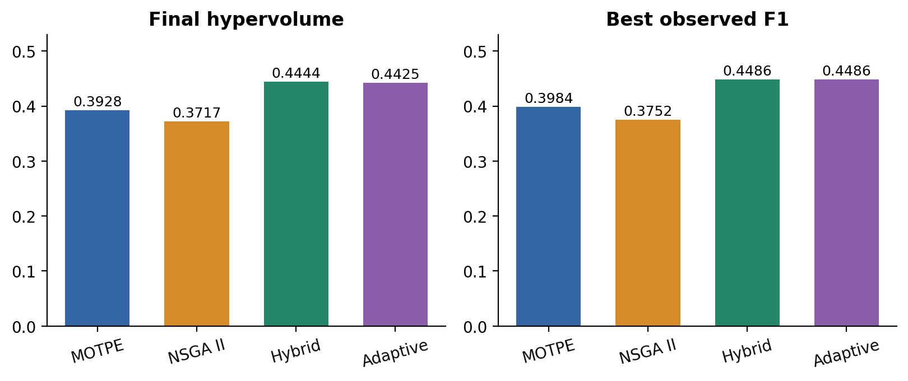

Relative to MOTPE, hybrid HV increased13.14 percent and adaptive HV increased12.67 percent; standard NSGA II HV was 5.37 percent lower. Hybrid and adaptive share the highest best F1, but have different final front tradeoffs. The hybrid versus adaptive HV difference is only 0.001863, approximately0.42 percent of adaptive HV.

Both failed attempts are duplicate_candidate events: one in MOTPE and one in hybrid. There were no eligible candidates with missing usage. Equal attempt budgets are therefore comparable under the stated duplicate charge policy; eligible evaluation counts are24 versus25 rather than silently forced equal.


# What the observed Pareto fronts show

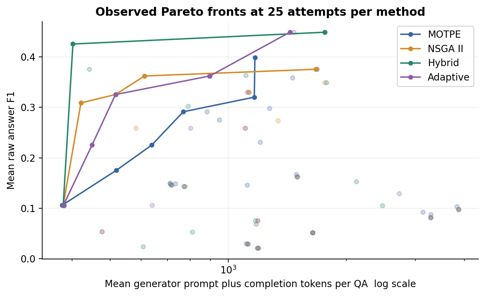

A line joins observed non dominated points for readability; intermediate points on that line have not necessarily been evaluated. The plot emphasizes that different configurations trade answer overlap against generation tokens. A higher point is better quality; a farther left point is lower resource.

Hybrid has a particularly strong point near402 tokens per QA at F1 0.4252 and also a higher quality point at 1762.8 tokens. Adaptive has its highest quality at 1435.7 tokens, lower cost than hybrid highest F1 point. Thus no single statement such as hybrid is cheapest at every quality level follows from its highest aggregate HV.

MOTPE discovered its own useful tradeoffs and a small exclusive contribution to the pooled empirical HV. Standard NSGA II final points add no exclusive pooled HV under the common reference, but its within arm front still represents tradeoffs found by that method. Front count includes equal objective ties, so the unique pair count is also reported in the raw table.


# Convergence by expensive candidate attempts

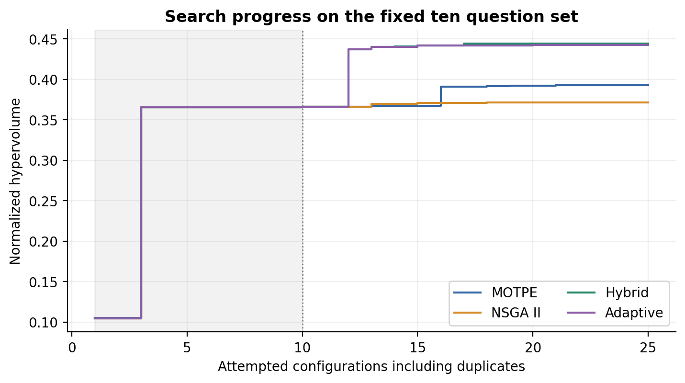

At checkpoint 10, only common initialization has run. Small score differences at that boundary arise from independent measured evaluations rather than evidence of an algorithm specific search advantage. The reference then obtains improvements through its remaining proposals; evolutionary arms use three five offspring generations.

| Method | HV at10 | HV at15 | HV at20 | HV at25 |
| --- | --- | --- | --- | --- |
| MOTPE | 0.366271 | 0.367165 | 0.392231 | 0.392754 |
| NSGA II | 0.366233 | 0.371062 | 0.371452 | 0.371658 |
| Hybrid | 0.366244 | 0.441597 | 0.444372 | 0.444376 |
| Adaptive | 0.366227 | 0.441805 | 0.442355 | 0.442513 |

The largest hybrid and adaptive quality gains appear early after initialization. Later gains are much smaller. This is observed short budget behavior, not proof that a method has converged globally. A flat section can reflect a small number of unhelpful proposals, duplicate costs or limited question resolution.


# Search efficiency and resource consumption

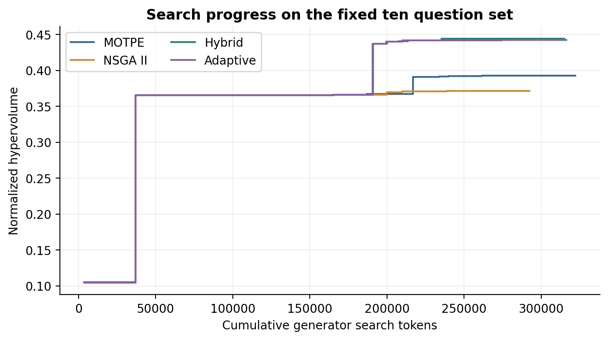

| Method | Generator tokens | Judge tokens | Calls |
| --- | --- | --- | --- |
| MOTPE | 322040 | 46254 | 905 |
| NSGA II | 292225 | 46997 | 944 |
| Hybrid | 314785 | 48059 | 937 |
| Adaptive | 316327 | 47770 | 1007 |

Across the native study, generator consumption was 1245377 tokens and diagnostic judge consumption189080 tokens. These are search totals, distinct from a deployed finalist per question cost. Standard NSGA II used fewer generator tokens than hybrid but achieved a smaller empirical frontier; lower expenditure alone does not establish better optimization.

The x axis represents actual logged generator usage, not API dollars or energy. Since different workflows may call the model several times, equal candidate budgets need not imply equal token budgets. The common attempt budget is primary; resource convergence adds a complementary view.


# Candidate quality distributions

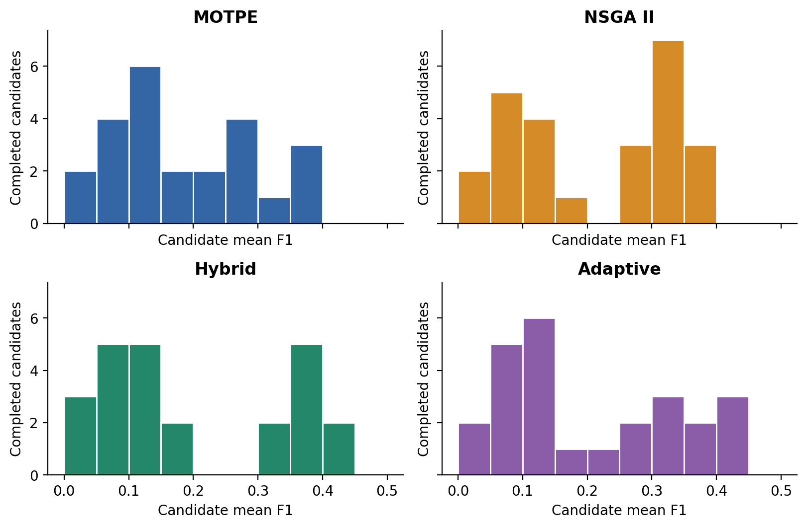

A histogram describes the configurations an optimizer evaluated. It is not the probability distribution of performance over the complete native space, because each optimizer adaptively chooses where to sample. The observed concentration and upper tail can therefore reflect both proposal policy and selection pressure.

Hybrid and adaptive extend to the largest observed F1 values. Standard NSGA II has no genetic offspring with a better F1 than its best shared initial configuration. MOTPE moves its upper end above initialization but does not reach the hybrid adaptive maximum in this run.

These outcomes do not justify treating the98 candidates as independent replicates for a significance test between algorithms: candidates share ten questions, are adaptively chosen and depend on preceding outcomes. Algorithm uncertainty would require repeated native optimizer runs, not error bars computed from a selected set of candidate qualities.


# Resource distributions and workflow counts

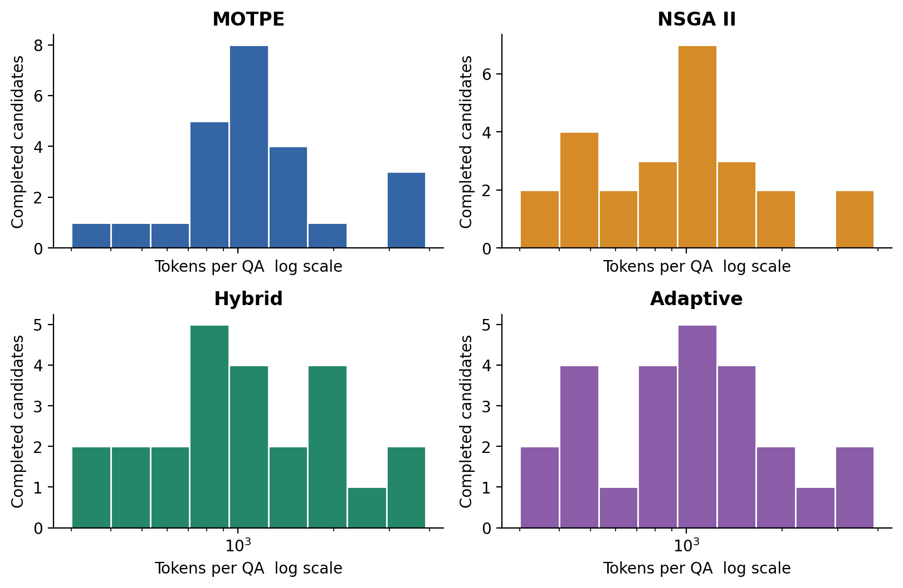

Conditional workflows can have very different numbers of nested calls. Decomposition, HyDE, reranking, dynamic examples and subquestion orchestration can change the prompt or trigger extra generation. A large token count therefore need not mean the model wrote a long final answer.

The distribution is useful for identifying expensive proposals and for explaining why a25 attempt campaign can still take hours. It does not isolate which module causes a cost increase, because configurations often change several fields together and are not randomly assigned module ablations.

Histograms exclude the two duplicates because those did not receive an eligible measured objective. They remain present in the attempt ledger, convergence x axis and failure table. This separation keeps the budget accounting and the distribution of actual measurements consistent.


# Question level behavior of the selected finalists

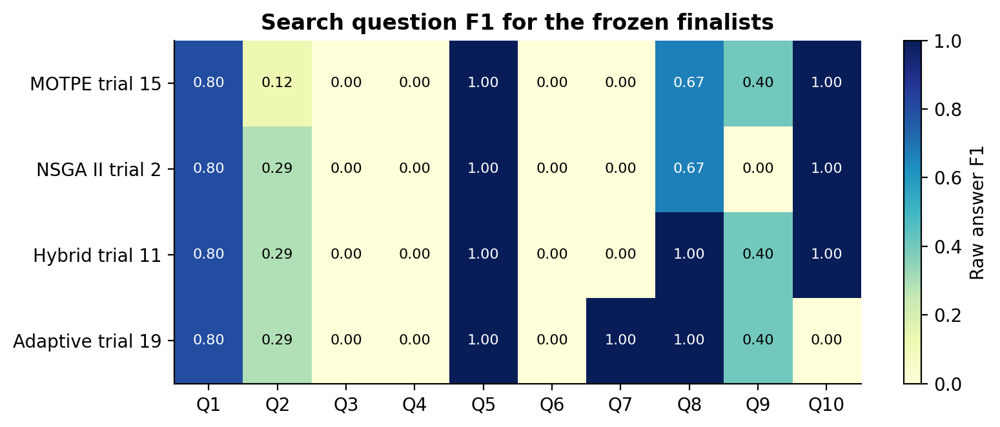

The frozen selections are MOTPE trial 15, standard NSGA II trial 2, hybrid trial 11 and adaptive trial 19. Q1 to Q10 follow the saved manifest order; the full IDs and actual question text are included in the appendix and machine readable evidence. A high average can depend on only a few questions changing.

Each mean is computed over the same ten references. One yes no question changing from a wrong to correct answer moves mean F1 by0.10. That is twice the difference between the best F1 of the reference and the tied hybrid adaptive result, so question level examination is essential before claiming robust quality improvements.

These finalist choices were frozen before native holdout outcomes, using maximum single point normalized HV, then F1, lower tokens and earliest trial. A later report must not choose a different finalist after looking at unseen answers and still describe the result as independent confirmation.


# Module usage and timing observations

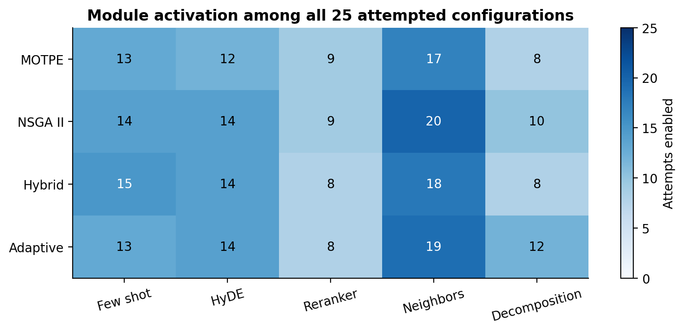

A frequently selected module may be part of shared initialization, linked to another branch, or retained after one favorable noisy answer. Its frequency does not establish that it improves quality. Similarly, comparing the average F1 of enabled versus disabled samples confounds the rest of the active configuration and optimizer selection history.

Wall time includes process startup, index construction and warm cache reuse as well as inference. Fixed arm order and shared pinned indexes can favor later evaluations. The final project includes workflow count and timing plots as descriptive diagnostics, but no claim that one optimizer has an unbiased wall clock speedup.

To estimate a module contribution, hold the remaining parameters fixed, repeat each enabled disabled setting on the same independent QA set, and account for stochastic or backend variation. That controlled experiment is future work rather than an analysis already completed here.


# Repeated configurations and operator diagnostics

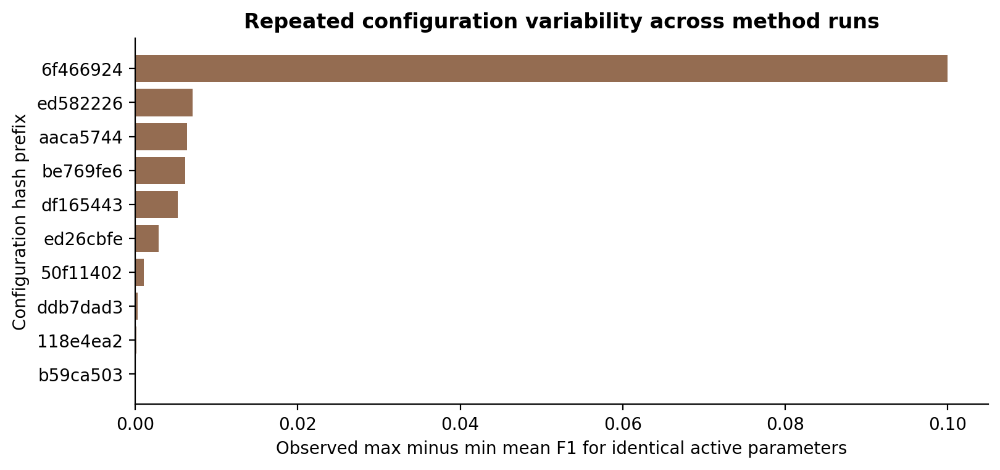

The largest observed cross arm range is 0.10 F1 for a configuration evaluated three times. Standard NSGA II trial 11 scored0.3485714286 while hybrid and adaptive trial 11 scored0.4485714286. The saved active parameters are identical. A yes no answer reversal on QA 5ae2cd3b5542996483e64a6d explains that aggregate difference.

The logs establish that the outcomes differ. They do not isolate whether the cause is backend generation, retrieval ordering, nested prompt construction or another runtime factor. Temperature zero does not by itself establish end to end deterministic RAG behavior. We do not retroactively replace these observations with a common cached score.

Adaptive mutation multiplier stayed1.0 in every generation. This is a separate limitation: the run did not activate its advertised strength change. The final adaptive score therefore cannot be offered as direct evidence that increasing mutation after stagnation improves search.


# Method specific findings and explanations

## MOTPE

At 25 attempts: eligible 24; best F1 0.398431; HV 0.392754; cheapest eligible measurement 377.2 generator tokens per QA; 6 unique front objective pairs.

Observed interpretation: TPE improved best quality beyond initialization. A duplicate consumed one slot. Its lower final HV than hybrid could reflect proposal locations and observed answer variation; one native seed does not isolate a density modelling weakness.

## NSGA II

At 25 attempts: eligible 25; best F1 0.375238; HV 0.371658; cheapest eligible measurement 379.8 generator tokens per QA; 5 unique front objective pairs.

Observed interpretation: lower cost offspring improved tradeoff coverage, but the highest F1 remained an initial point. Five survivors and three generations offer little evolutionary search depth. This is a plausible constraint, not an experimentally established explanation of the lower score.

## Hybrid

At 25 attempts: eligible 24; best F1 0.448571; HV 0.444376; cheapest eligible measurement 379.8 generator tokens per QA; 3 unique front objective pairs.

Observed interpretation: it achieved the largest final HV, and genetic offspring supplied its strongest quality and low token tradeoff. Injection trials did not beat the genetic maximum F1. We cannot infer that Bayesian guidance alone caused the advantage without an injection ablation.

## Adaptive

At 25 attempts: eligible 25; best F1 0.448571; HV 0.442513; cheapest eligible measurement 380.3 generator tokens per QA; 5 unique front objective pairs.

Observed interpretation: it reached the joint highest quality and a strong final front. Its adaptation trigger never fired. Independent reevaluation changed early outcomes and can change downstream selection even when nominal mutation strength matches standard NSGA II.

The supported answer to why is therefore bounded: recorded candidate origins, answers, costs and adaptation signals explain what happened, while causal attribution to a search component remains unresolved.


# The separate compact three parameter experiment

To obtain a small fully measured fallback landscape, we fixed a simpler RAG pipeline and varied retrieval depth k, chunk size c and context token budget Bc. The grid was k in2 4 6, c in256 512 1024, and Bc in512 1024 2048, giving27 configurations. The same local Qwen family and BGE small embedding were used, with a256 token output cap and a5000 token HV reference. [E2]

The pipeline measured the finite grid progressively on one, three and five search questions. Optimizer trajectories then queried the already measured final five question landscape. Four methods, ten optimizer seeds and 25 logical queries per seed were replayed. This is not forty independent GPU optimization campaigns; response caching and fitness replay reduce actual computation.

| Compact outcome | Verified finding |
| --- | --- |
| Final HV all methods | 0.5229264 in every optimizer seed |
| Measured front recovery | All methods recovered the same observed finite grid front |
| Initialization saturation | Seven of ten initial pools already contained the entire front |
| Distinct settings mean | MOTPE20.5 NSGA17.0 hybrid18.0 adaptive18.3 |
| Physical generator use | 77 calls and47228 tokens; zero failed calls |
| Logical search rows | 27 settings times5 questions equals135 rows |
| Selected holdout rows | Three distinct selected configurations times5 questions equals15 rows |

All four final scores tying is a useful negative result. The grid was small and redundant enough that the common startup often solved the optimizer task already. This gives no evidence of evolutionary superiority and does not demonstrate equivalence in a much larger native conditional space.


# Compact holdout and what it adds

| Frozen compact representative | Search F1 | Holdout F1 | Holdout EM |
| --- | --- | --- | --- |
| k4 c256 Bc512 | 0.5600 | 0.2571 | 0.20 |
| k4 c512 Bc512 | 0.5600 | 0.2571 | 0.20 |
| k4 c1024 Bc512 | 0.5600 | 0.0571 | 0.00 |

The compact selected representatives had strong search F1 but much weaker performance on five held out questions. Each holdout configuration averaged535.6 tokens per QA. This is direct evidence that a small search set can overstate generalization, although the compact holdout has a different corpus and difficulty composition and does not isolate a single failure cause.

Deduplicating forty method seed selections left only three distinct settings. Repeated selections do not create forty independent holdout experiments. The small difference among method averaged holdout scores is therefore not robust evidence that standard NSGA II generalizes better.

## Parameter observations from the complete compact grid

Marginal mean F1 was 0.46 at k2,0.56 at k4 and 0.5156 at k6. Increasing retrieval depth did not monotonically improve quality. The smallest context budget had the highest marginal F1 and lowest mean token cost in this measured grid. Chunk size1024 had slightly higher marginal search F1 but the worst selected holdout representative.

These are finite sample observations, not universally recommended production hyperparameters. The compact reference 5000 differs from native 50000; compact 5 search QA differs from native 10; compact cached landscape replay differs from native independent evaluations. Do not directly rank the two experiments by their absolute HV values.

A larger60 setting compact extension was prepared and software tested but no measured return was received. It is excluded from completed research claims. The project proceeds with the compact 27 and restricted native 25 evidence only.


# Research questions answered by the completed data

| Research question | Answer supported by evidence |
| --- | --- |
| Can the Syftr workflow be evaluated with available local models | Yes. Native local integration completed98 eligible configurations with verified raw objectives and usage. |
| Which method had the best observed native frontier | Hybrid at HV0.444376; adaptive0.442513; MOTPE0.392754; NSGA0.371658. |
| Did every evolutionary alternative beat the reference | No. Standard NSGA II had lower final HV and best F1. |
| Did hybrid injections cause the best quality result | Not established. The best hybrid F1 came from genetic trial11; injection maximum F1 was lower. |
| Did adaptation improve mutation strength during the run | No activation was observed. The multiplier remained one in all three generations. |
| Does a larger token budget always improve quality | No monotonic guarantee is seen; compact k6 spent more without matching k4 marginal F1. |
| Did the compact study show evolutionary superiority | No. All four methods recovered the same measured finite grid frontier. |

A research question can have a negative or inconclusive answer and still be valuable. The study is strongest when it separates the observed ranking from the stronger causal claims its design cannot support.


# Research questions that remain open

| Question | Current answer and needed evidence |
| --- | --- |
| Will native winners generalize to unseen questions | Unknown. No usable native holdout result; evaluate frozen finalists on disjoint QA. |
| Is the native ranking stable across optimizer seeds | Unknown. Repeat the same declared protocol with several seeds and common initialization control. |
| How much variation comes from repeated fitness evaluation | Observed variation exists. Repeat identical finalist configurations and inspect retrieval prompts and backend behavior. |
| Does BO intervention frequency matter | Not tested. Compare zero one two or more injection slots at matched budgets. |
| Can adaptive mutation help during stagnation | Not tested here. Run longer search or a deliberately stagnant task and compare controlled strengths. |
| Which module causally improves quality cost | Not isolated. Use fixed base configurations and matched enabled disabled comparisons. |
| Does the ranking hold in the full paper space | Unknown. Larger workflow model catalogue and additional datasets were not completed. |
| Is there an unbiased runtime or energy winner | Unknown. Need controlled cache state randomized arm order and actual resource measurements. |

These open questions set the boundary of the contribution. They should appear in the report discussion and presentation questions rather than being filled with speculative explanations. The current evidence supports a reproducible exploratory comparison, not a final deployment recommendation.


# Threats to validity and responsible conclusions

## Internal validity

Only proposal policies are intentionally varied, but independently evaluated fitness is not perfectly repeatable. Early answer differences can change evolutionary survivor sets and all later trajectories. Fixed arm order and warm shared indexes confound timing. The hybrid includes both genetics and Bayesian proposals, so an overall win does not identify which component caused it.

## Measurement validity

F1 measures token overlap and can disagree with semantic correctness. The local judge was not retained as the primary quality measure. Token counts are verified, but they exclude embedding compute and do not represent money or energy. HV depends on its declared reference, and pooled IGD measures proximity to an observed pooled frontier rather than a true optimum.

## External validity

One quantized Qwen model, one HotPotQA subset,4972 grounding documents, ten search questions, one optimizer seed and 25 attempts cannot represent the original paper diverse datasets and model catalogue. The absence of native holdout prevents a native generalization claim. Compact holdout results show why that distinction matters.

## Statistical validity

The98 eligible candidates are selected dependent observations, not98 independent seeds. The980 rows reuse ten questions. No between optimizer significance test is justified by inflating this count. The compact ten seed replay repeats search decisions on one fixed measured landscape; it does not capture new generation uncertainty.

A defensible conclusion is that the implemented hybrid attained the best observed restricted search frontier under this budget, with useful alternative tradeoffs, while standard NSGA II did not outperform the local reference and adaptive mechanism benefit remained untested. Broader superiority remains an open question.


# A practical explanation for presentation questions

## Why not use the entire paper space

The paper space combines many hosted models and expensive agentic flows. The team lacked those APIs and had limited execution time. We declared one common feasible subset instead of pretending a smaller run reproduced the full paper. All four methods face the same subset and budget.

## Why did six hours of execution produce only100 attempts

Each attempt answers ten questions, can build or reuse a retrieval index, and can trigger multiple nested model calls plus diagnostic judging. The study recorded more than 1.24 million generator tokens. A25 attempt budget per method is not25 single chat responses. Reported wall time also includes setup or recovery, so it is not an isolated algorithm cost.

## Is hybrid the best algorithm

It is the observed winner under the declared native search protocol. The data do not prove universal superiority or a causal effect of injections. The strongest hybrid quality point was genetic, repeated evaluation varied and native holdout is missing.

## What is original work here

The contribution is the local adaptation and instrumented common evaluator, a conditional genetic representation using native Syftr sampling, implemented evolutionary and hybrid feedback policies, recovery aware experiment control, and audited empirical comparisons. The study reuses established algorithms and the base framework rather than claiming invention of NSGA II or TPE.

## What can we show if asked for proof

Show the exact source folder, the candidate ledger and raw QA rows, endpoint usage journals, final manifest and receipt, generated figures and the independent audit JSON. A screenshot alone is weaker evidence than a consistent chain from protocol to raw answer to objective to final plot.


# The final implementation folder and code walkthrough

| Final folder | What to demonstrate |
| --- | --- |
| 01_documentation | This PDF and Word document figures data tables and evidence references |
| 02_implementation/native_exact | Exact executed project source from the final Kaggle export |
| 02_implementation/compact | Separate compact landscape measurement and replay implementation |
| 03_results/native_restricted | Audited final capsule and extracted raw campaign |
| 03_results/compact | Compact original capsule audit findings and raw artifacts |
| 04_reproducibility | Deployment packages fixed Kaggle notebook recovery helpers analysis scripts and environment records |
| 05_reference_material | Supplied base paper proposal and earlier project analysis |
| MANIFEST.json and README.md | File integrity inventory entry points scope and honest completion status |

For code explanation, begin with native_exact/ourwork/baseline/spec.py and the restricted override. Then show adapter.prepare returning the native StudyConfig. Follow baseline.run into execute_job and worker.evaluate_candidate, inspect proxy journals, and finally open optimizers/space.py, nsga2.py and bridge.py. The same worker is used by every method.

Inspect one candidate job.json to connect the source to the recorded settings. Open its questions.jsonl and calls.jsonl to explain quality and cost. The trial SQLite objective is recomputed by campaign_v2/report.py before a point is allowed into the reported comparison. The report figures are derived from these stored objectives and diagnostics.


# Reproducing analysis and keeping evidence safe

## Replot without GPU execution

The final folder contains an offline reproduction entry point that audits stored records and regenerates figures from the archived campaign. It uses Optuna4.2.1 for native ledger interpretation and Matplotlib for figures. It never starts a model server and never deserializes a sampler pickle. Requirements and commands are in the root README and reproducibility folder.

## Rerunning inference is a different task

A fresh Kaggle inference campaign requires the original private restricted dataset package, a T4x2 runtime, Internet for pinned model downloads and the fixed safe notebook loader. Runtime absolute paths are intentionally Kaggle specific. Do not try to execute every loose source file or resume the historical lost baseline from a summary. The portable deployment package and recorded revisions preserve the correct setup path.

## Integrity checks

The final project manifest lists each packaged file with byte size and SHA256. Original receipts and capsule manifests preserve the received identities. Verify before extracting or presenting results. Keep source and evidence separate from new experiment outputs so a report rebuild does not overwrite original measurements.

## Completed research and unfinished validation

The final restricted search has all 100 attempts accounted for, and the compact experiment has measured results and its own report. Native holdout has no usable result and no significance claim is made. The final report and presentation can be written from this evidence without more Kaggle computation, as long as these limits remain explicit.

Copy the final project ZIP to another drive or cloud location. A second folder on the same disk protects against accidental edits but not complete disk failure. Model weight caches are omitted from the final project; pinned revisions and the original deployment assets make them reproducible.


# Appendix A Exact finalist configurations

The selected configurations below were frozen before attempted native confirmation. They are not chosen after looking at holdout answers. Only active concrete parameters matter for identity. Full parameter dictionaries for all100 attempts are in data_tables/all_100_attempts.csv.

## MOTPE trial 15

few_shot_enabled=True; rag_mode=rag; template_name=concise; rag_method=hybrid; rag_query_decomposition_enabled=True; rag_top_k=3; rag_embedding_model=BAAI/bge-small-en-v1.5; rag_hybrid_bm25_weight=0.1; rag_query_decomposition_num_queries=3; rag_fusion_mode=simple; splitter_method=recursive; splitter_chunk_exp=10; splitter_chunk_overlap_frac=0.1; reranker_enabled=True; reranker_top_k=3; hyde_enabled=False; additional_context_enabled=True; additional_context_num_nodes=2; few_shot_top_k=4; few_shot_embedding_model=BAAI/bge-base-en-v1.5

Measured search F1 0.398431373; generator tokens per QA 1169.6. All active LLM modules use the common pinned local generator with the fixed decoding stated earlier.

## NSGA II trial 2

few_shot_enabled=True; rag_mode=rag; template_name=concise; rag_method=hybrid; rag_query_decomposition_enabled=True; rag_top_k=5; rag_embedding_model=BAAI/bge-base-en-v1.5; rag_hybrid_bm25_weight=0.8; rag_query_decomposition_num_queries=2; rag_fusion_mode=simple; splitter_method=token; splitter_chunk_exp=9; splitter_chunk_overlap_frac=0.0; reranker_enabled=True; reranker_top_k=4; hyde_enabled=True; additional_context_enabled=True; additional_context_num_nodes=4; few_shot_top_k=3; few_shot_embedding_model=BAAI/bge-base-en-v1.5

Measured search F1 0.375238095; generator tokens per QA 1673.8. All active LLM modules use the common pinned local generator with the fixed decoding stated earlier.


# Appendix B Evolutionary finalist configurations

## Hybrid trial 11

few_shot_enabled=True; rag_mode=rag; template_name=concise; rag_method=dense; rag_query_decomposition_enabled=True; rag_top_k=5; rag_embedding_model=BAAI/bge-base-en-v1.5; rag_query_decomposition_num_queries=2; rag_fusion_mode=simple; splitter_method=recursive; splitter_chunk_exp=9; splitter_chunk_overlap_frac=0.0; reranker_enabled=True; reranker_top_k=4; hyde_enabled=True; additional_context_enabled=True; additional_context_num_nodes=4; few_shot_top_k=3; few_shot_embedding_model=BAAI/bge-base-en-v1.5

Measured search F1 0.448571429; generator tokens per QA 1762.8. These scores belong to ten search questions, not an independent test.

## Adaptive trial 19

few_shot_enabled=True; rag_mode=rag; template_name=concise; rag_method=dense; rag_query_decomposition_enabled=True; rag_top_k=5; rag_embedding_model=BAAI/bge-base-en-v1.5; rag_query_decomposition_num_queries=2; rag_fusion_mode=simple; splitter_method=recursive; splitter_chunk_exp=9; splitter_chunk_overlap_frac=0.0; reranker_enabled=True; reranker_top_k=4; hyde_enabled=False; additional_context_enabled=True; additional_context_num_nodes=3; few_shot_top_k=2; few_shot_embedding_model=BAAI/bge-base-en-v1.5

Measured search F1 0.448571429; generator tokens per QA 1435.7. These scores belong to ten search questions, not an independent test.

Trial numbers are zero based: trial 11 is the twelfth attempted candidate. A shared initial configuration can remain the finalist if later search does not improve its declared single point HV. A finalist need not be the cheapest point on the full Pareto front.


# Appendix C Complete final Pareto measurements

| Method | Trial | Mean F1 | Generator tokens per QA |
| --- | --- | --- | --- |
| MOTPE | 0 | 0.105882353 | 377.2 |
| MOTPE | 15 | 0.398431373 | 1169.6 |
| MOTPE | 16 | 0.320000000 | 1165.3 |
| MOTPE | 17 | 0.175238095 | 519.0 |
| MOTPE | 18 | 0.225238095 | 638.6 |
| MOTPE | 22 | 0.291111111 | 768.4 |
| NSGA II | 2 | 0.375238095 | 1673.8 |
| NSGA II | 14 | 0.325238095 | 516.2 |
| NSGA II | 17 | 0.308571429 | 421.4 |
| NSGA II | 19 | 0.105882353 | 379.8 |
| NSGA II | 22 | 0.308571429 | 421.4 |
| NSGA II | 24 | 0.361904762 | 611.9 |
| Hybrid | 11 | 0.448571429 | 1762.8 |
| Hybrid | 16 | 0.425238095 | 402.1 |
| Hybrid | 21 | 0.105882353 | 379.8 |
| Adaptive | 12 | 0.361904762 | 897.5 |
| Adaptive | 14 | 0.325238095 | 516.2 |
| Adaptive | 17 | 0.105882353 | 380.3 |
| Adaptive | 19 | 0.448571429 | 1435.7 |
| Adaptive | 20 | 0.325238095 | 516.2 |
| Adaptive | 24 | 0.225238095 | 449.8 |

Equal objective ties are retained as separate configurations by pareto_indices. NSGA trials17 and22 share an objective pair, as do adaptive14 and20. The comparison JSON includes both total frontier configurations and unique objective pairs. The token measure includes prompt and output across all generation calls.


# Appendix D Questions and raw answer examples

### Q1 5ae60b9b554299546bf8302f

The 2013 Indiana Hoosiers football team were lead by which current offensive coordinator at Ohio State?

Reference: Kevin Reece Wilson | MOTPE finalist answer: Kevin Wilson | F1 0.800000

### Q2 5a8a582a5542995153361372

What do it yourself magazine does William Gurstelle write for?

Reference: Make | MOTPE finalist answer: William Gurstelle writes for DIY and do it with others (DIWO) projects featured in "Make" magazine. | F1 0.117647

### Q3 5a8ba7d75542996e8ac88991

How long was the Underdog show presented by an English comedian Julian Clary?

Reference: six-week television series | MOTPE finalist answer: Six weeks. | F1 0.000000

### Q4 5a87432d5542994775f607b5

Has Alek Keshishian been the writer for more films than Mark Krikorian?

Reference: yes | MOTPE finalist answer: no | F1 0.000000

### Q5 5a8299e255429954d2e2eb76

Apart from the founder of the Exclusive Brethren, what is the name of the second person who was sent by the Plymouth Brethren to investigate the outbreak of supernatural gifts of the Holy Spirit in Scotland?

Reference: Benjamin Wills Newton | MOTPE finalist answer: Benjamin Wills Newton | F1 1.000000

These are unedited recorded final answers apart from normal document wrapping. They illustrate lexical scoring and answer behavior, not a separate manually adjudicated semantic benchmark. Raw requests and all model responses remain in the result archive.


# Appendix E Remaining search questions and variability

### Q6 5adf8aea5542993344016ce9

In what year was the woman whose former chief of staff was Rachel Noerdlinger born?

Reference: 1954 | MOTPE finalist answer: 1970 | F1 0.000000

### Q7 5a76a59a5542993569682c72

Who was the original executive producer of the children's television series, produced by Sesame Workshop and created by Joan Ganz Cooney and Lloyd Morrisett?

Reference: David Connell | MOTPE finalist answer: Joan Ganz Cooney | F1 0.000000

### Q8 5ae6e6d15542992ae0d163a5

What is the stage name of the singer who is starring in "The Underdog" alongside Park So-dam and Park Chul-min?

Reference: D.O. | MOTPE finalist answer: Do Kyung-soo | F1 0.666667

### Q9 5a7f3d325542992e7d278cb5

Fuck and The Celluloid Closet are both what?

Reference: documentary film | MOTPE finalist answer: both documentary films | F1 0.400000

### Q10 5ae2cd3b5542996483e64a6d

Do both MODE and Women's Health focus on the issues faced by women?

Reference: yes | MOTPE finalist answer: yes | F1 1.000000

## A concrete repeatability example

NSGA II trial 11: answer 'no'; reference 'yes'; question F1 0.0.

Hybrid trial 11: answer 'yes'; reference 'yes'; question F1 1.0.

Adaptive trial 11: answer 'yes'; reference 'yes'; question F1 1.0.


# Appendix F Pinned assets and configuration records

The exact nested source manifest is included in every native protocol.json and the final project environment records. The principal revision identifiers are listed below for offline inspection.

### Generator model revision

{"revision": "bb5d59e06d9551d752d08b292a50eb208b07ab1f", "source": "https://huggingface.co/api/models/Qwen/Qwen2.5-7B-Instruct-GGUF", "files": ["qwen2.5-7b-instruct-q4_k_m-00001-of-00002.gguf", "qwen2.5-7b-instruct-q4_k_m-00002-of-00002.gguf"]}

### Dataset source

{"revision": "9f0ca285022ab1d7741ec681bf8add538f87db33", "source": "https://huggingface.co/api/datasets/DataRobot-Research/hotpotqa"}

This source catalogue preserves earlier capability pins too. Only BGE small and BGE base are allowed active embeddings in the final restricted search; the other listed embeddings are not additional evaluated arms.

| Pinned asset | Revision |
| --- | --- |
| Qwen/Qwen2.5-7B-Instruct | a09a35458c702b33eeacc393d103063234e8bc28 |
| BAAI/bge-small-en-v1.5 | 5c38ec7c405ec4b44b94cc5a9bb96e735b38267a |
| BAAI/bge-large-en-v1.5 | d4aa6901d3a41ba39fb536a557fa166f842b0e09 |
| thenlper/gte-large | 4bef63f39fcc5e2d6b0aae83089f307af4970164 |
| mixedbread-ai/mxbai-embed-large-v1 | b33106f585b9ce46904ad7443a3b52b7a63e231c |
| WhereIsAI/UAE-Large-V1 | 9c9b2c999b3350cfb3171ed429320668e39b00b8 |
| avsolatorio/GIST-large-Embedding-v0 | 7831200e2f7819b994490c091cf3258a2b821f0c |
| w601sxs/b1ade-embed | ee4c9b262a551a94502063f8224f08a7349762e1 |
| Labib11/MUG-B-1.6 | ee7247c4287125f08433d7e578e0ae85448687e4 |
| sentence-transformers/all-MiniLM-L12-v2 | a50ef00143b4d5391434df20ae11632588ac25be |
| sentence-transformers/paraphrase-multilingual-mpnet-base-v2 | 4328cf26390c98c5e3c738b4460a05b95f4911f5 |
| BAAI/bge-base-en-v1.5 | a5beb1e3e68b9ab74eb54cfd186867f64f240e1a |

Generator revision bb5d59e06d9551d752d08b292a50eb208b07ab1f. llama.cpp revision32bdc3a89e6528d3e419024c833c5dabf32c7541. Dataset revision9f0ca285022ab1d7741ec681bf8add538f87db33. Exact GGUF shard checksums are in server_metadata.json; they were preserved with the returned baseline metadata.

Final returned bundle SHA256 b131713b8dcb20df388eafe3f737160a6d3ab751014dd0ef4744a4839b4dc4ca. Nested research capsule SHA256 d5509684f8330a1772dbfd0216c6ec38831a3ae8ec6a388ff16c04d66070d07c. These are content identities, not scientific confidence estimates.


# Appendix G Complete native gene catalogue

The recorded native distribution catalogue contains 55 fields, of which 23 are nonconstant and 32 are fixed. Some fields belong to unreachable workflow branches. They are included in the genome catalogue but do not become active parameters in the restricted phenotype.

| Gene name | Recorded variable distribution |
| --- | --- |
| rag_mode | rag, sub_question_rag |
| template_name | default, concise, CoT |
| few_shot_enabled | True, False |
| hyde_enabled | True, False |
| reranker_enabled | True, False |
| additional_context_enabled | True, False |
| few_shot_top_k | 2 to 4 step 1 log False |
| few_shot_embedding_model | BAAI/bge-small-en-v1.5, BAAI/bge-base-en-v1.5 |
| rag_method | dense, sparse, hybrid |
| rag_query_decomposition_enabled | True, False |
| rag_top_k | 2 to 6 step 1 log False |
| rag_embedding_model | BAAI/bge-small-en-v1.5, BAAI/bge-base-en-v1.5 |
| rag_hybrid_bm25_weight | 0.1 to 0.9 step 0.1 log False |
| rag_query_decomposition_num_queries | 2 to 3 step 1 log False |
| rag_fusion_mode | simple, reciprocal_rerank, relative_score, dist_based_score |
| splitter_method | recursive, sentence, token |
| splitter_chunk_exp | 8 to 10 step 1 log False |
| splitter_chunk_overlap_frac | 0.0 to 0.2 step 0.1 log False |
| reranker_top_k | 2 to 4 step 1 log False |
| additional_context_num_nodes | 2 to 4 step 1 log True |
| lats_num_expansions | 2 to 3 step 1 log False |
| lats_max_rollouts | 2 to 5 step 1 log False |
| coa_enable_calculator | False, True |

lats_num_expansions, lats_max_rollouts and coa_enable_calculator are generic catalogue fields. LATS and critique workflows are not permitted in restricted v2, so these fields do not enlarge the active restricted experiment. All fixed LLM fields remain visible in distributions.json. Hybrid BM25 weight and fusion mode are explicitly included above rather than omitted from the space description.


# Compact landscape and optimizer replay figures

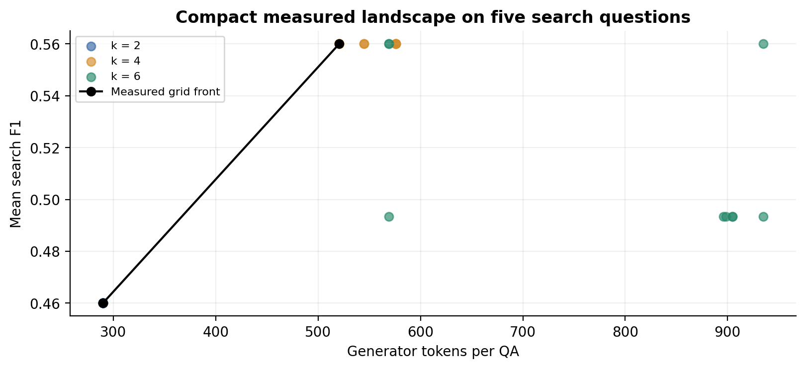

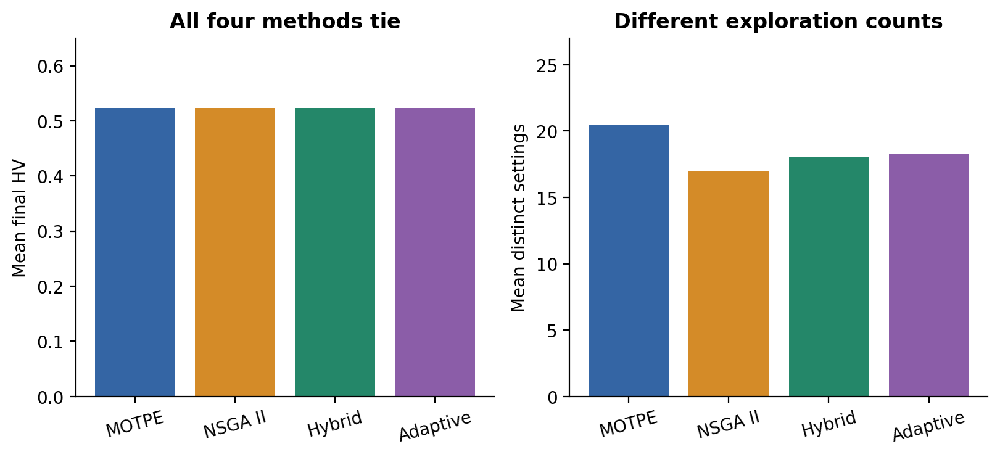


# Appendix H Additional comparative measurements

| Method | Pooled front IGD | Exclusive HV | Mean eligible F1 |
| --- | --- | --- | --- |
| MOTPE | 0.027104 | 0.00000551 | 0.189999 |
| NSGA II | 0.043212 | 0.00000000 | 0.209737 |
| Hybrid | 0.002198 | 0.00138496 | 0.196543 |
| Adaptive | 0.010412 | 0.00015265 | 0.204606 |

IGD uses the pooled empirical front with a common token scale of 50000; lower is better. Exclusive HV is the amount lost from the pooled set if an entire method is removed. Neither measure proves distance to a global optimum. Mean eligible F1 averages an adaptively selected configuration set, not random samples from the full space.

## Best quality under a token ceiling

| Method | At most500 | At most1000 | At most2000 | At most5000 |
| --- | --- | --- | --- | --- |
| MOTPE | 0.105882 | 0.291111 | 0.398431 | 0.398431 |
| NSGA II | 0.308571 | 0.361905 | 0.375238 | 0.375238 |
| Hybrid | 0.425238 | 0.425238 | 0.448571 | 0.448571 |
| Adaptive | 0.225238 | 0.361905 | 0.448571 | 0.448571 |

Ceilings apply to mean full generator tokens per QA, not context tokens alone. These are best recorded search qualities at that cost constraint, not recommendations validated on unseen questions.

## Pairwise front coverage

| Covering method | MOTPE | NSGA II | Hybrid | Adaptive |
| --- | --- | --- | --- | --- |
| MOTPE | Same | 0.333 | 0.333 | 0.167 |
| NSGA II | 0.667 | Same | 0.333 | 0.833 |
| Hybrid | 0.833 | 1.000 | Same | 0.833 |
| Adaptive | 0.667 | 0.333 | 0.333 | Same |

Each cell is the fraction of the column method front weakly dominated by at least one row method point. Identical objective points count as covered. Coverage is directional and can differ from the HV ranking because a method can contribute strong points in only part of the tradeoff space.


# References and evidence index

[S1] Conway A, Dey D, Hackmann S, Hausknecht M, Schmidt M, Steadman M and Volynets N. syftr Pareto Optimal Generative AI. arXiv2505.20266v1,26 May2025. Supplied PDF syftr-BasePaper.pdf. Sections3 to6 support the framework optimizer pruning datasets and original evaluation description.

[S2] Research Methodology team. RM.pptx supplied proposal. Slides11 to25 specify the optimizer comparison, controlled factors and proposed mechanisms; slide 4 gives the compact k c Bc formulation. The title page team details are transcribed from this proposal.

[E1] Final restricted native export restricted_final_complete_20261116_142224. Four verified binary parts and receipt, outer bundle manifest, nested capsule manifest, final comparison, raw candidate rows and independent AUDIT_at_25.json. Primary source for native quantitative claims.

[E2] Completed compact_kcb_review.zip and receipt, AUDIT.json, FINDINGS.md, measured27 setting landscape, replay trajectories and holdout_measurements.json. Source for all compact claims; distinct from native E1.

[I1] Exact executed source returned inside E1, including baseline adapter worker proxy run metrics, optimizers ConditionalSpace EvolutionSearch EvolutionSampler, and campaign controller report snapshots. Source for algorithm and implementation descriptions.

[H1] Root context.md and earlier detailed project analysis. Chronological record of decisions pilot capability checks infrastructure fixes and experimental boundaries. Historical lost baseline summaries are not used as completed comparison measurements.

Established algorithm names refer to NSGA II and tree structured Parzen estimation as implemented and explained in the included source and base paper. This project does not claim to invent these algorithms. No new external benchmark result is inferred from software tests or report graphics.

All new charts in this document are generated from the locally preserved measurements by analyze_and_plot.py. The final project includes figure PNG and PDF exports, source tables and the deterministic document builder. Native holdout is unavailable; medium60 has no measured return; no missing values have been filled with fabricated results.


# Additional diagnostic views

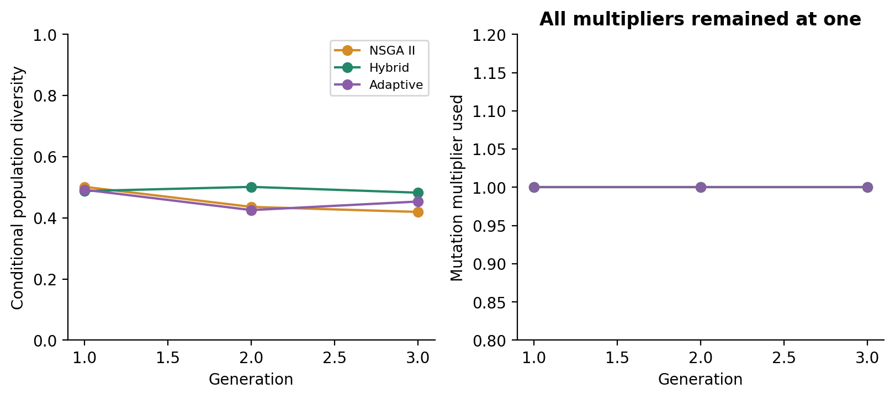

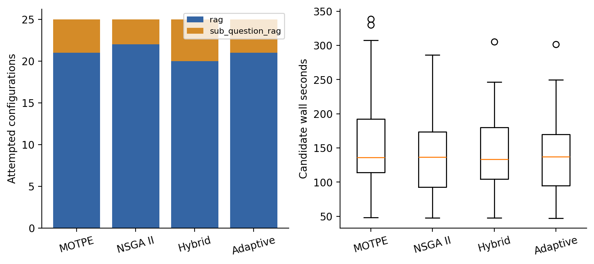
